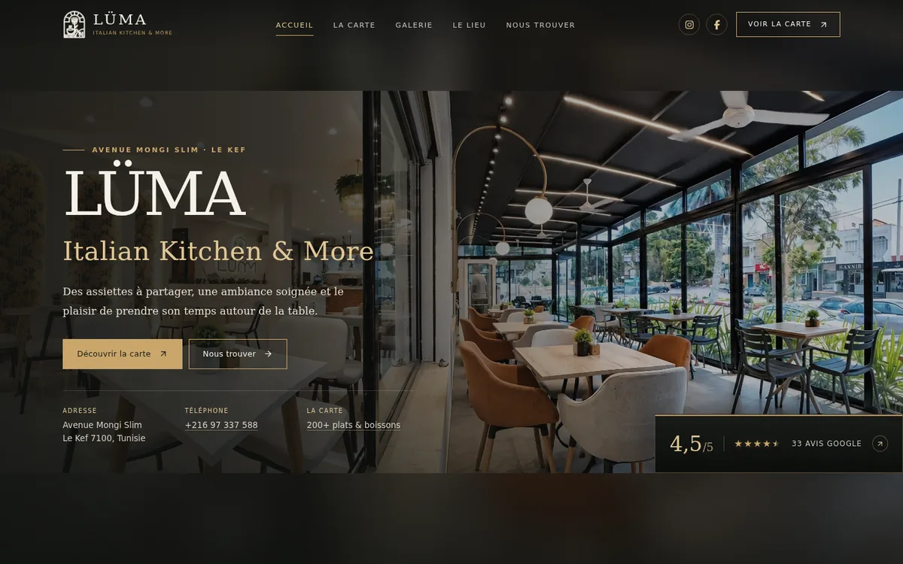
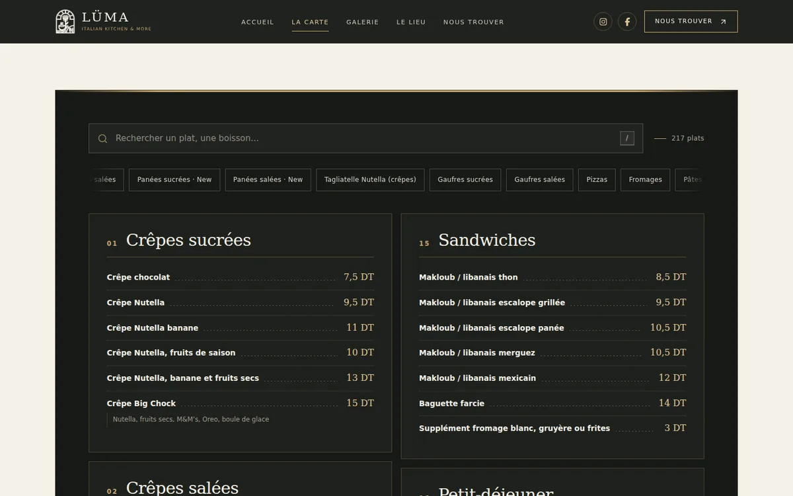
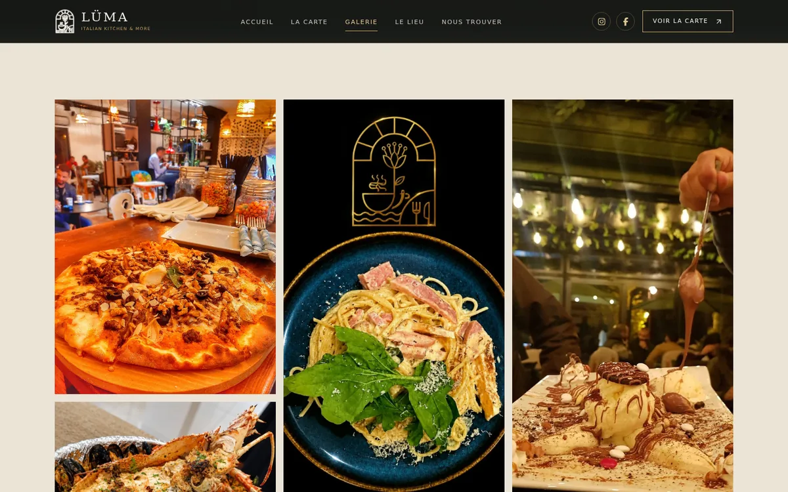

# LÜMA — Italian Kitchen & More

A five-page static website for **LÜMA — Italian Kitchen & More**, a restaurant in
Le Kef, Tunisia. Built from the restaurant's own photographs and menu screenshots,
with no framework, no build step and no runtime dependencies.

**Live demo:** [m-stoufa.github.io/LumaRestaurant](https://m-stoufa.github.io/LumaRestaurant/)

> **Demo only — not the restaurant's official site.** Every page carries
> `noindex,nofollow`. Menu prices, contact details and social links must be
> confirmed with the owner before any official launch.



## Pages

| Page | What it contains |
| --- | --- |
| [`index.html`](index.html) | Home: video hero, menu preview, atmosphere section, gallery preview and contact details |
| [`menu.html`](menu.html) | Full menu — **217 entries in 23 categories** — with live search, category filters and a result counter |
| [`gallery.html`](gallery.html) | A **13-photo full gallery** with an accessible lightbox (keyboard arrows, Escape, touch swipe) |
| [`about.html`](about.html) | The restaurant, using only the identity and details supplied in the project handoff |
| [`contact.html`](contact.html) | Address, telephone, Instagram, Facebook and Google Maps directions |

| Menu | Gallery |
| --- | --- |
|  |  |

## What is included

- **217 dishes and drinks** transcribed from the supplied menu pages, with prices in
  Tunisian dinars and the original French/Italian names preserved.
- **Real HTML menu**, not a PDF or image: search covers dish and category names, the
  category chips filter the list, and the count updates as you type.
- **Responsive layout** with a mobile drawer, horizontal filter rail and snap-scrolling
  food cards on small screens.
- **Original photography only** — no stock photos, no AI-generated imagery and no
  external image URLs.
- **Accessible interactions** — skip link, visible focus states, labelled controls,
  `aria-pressed` filters, an `aria-live` result count, keyboard-operable lightbox and a
  `prefers-reduced-motion` path.
- **Performance-minded assets** — responsive images with intrinsic dimensions, lazy
  loading below the fold, eager hero media with a poster fallback, and self-hosted assets.
- **Structured page metadata** — per-page titles and descriptions, shared navigation
  and `noindex,nofollow` while the demo remains unapproved.

## Tech stack

`HTML5` · `CSS3` · `vanilla JavaScript` · served as static files

No package manager, framework, bundler or backend is required.

## Run locally

From the project folder:

```bash
python3 -m http.server 8000
```

Open <http://localhost:8000>. Any static file server works.

## Project structure

```text
.
├── index.html              # Home
├── menu.html               # Full menu + search/filter UI
├── gallery.html            # Gallery + lightbox
├── about.html              # Restaurant page
├── contact.html            # Contact and directions
├── assets/
│   ├── css/site.css        # Shared design system and responsive layout
│   ├── js/site.js          # Navigation, menu search/filters, gallery, lightbox
│   ├── js/menu-data.js     # 217 menu entries in 23 categories
│   ├── photos/             # Supplied restaurant photography and brand marks
│   └── videos/             # Hero video and poster fallback
├── docs/screenshots/       # README screenshots
├── MENU_VERIFICATION.md    # Menu sources, corrections and flagged readings
├── QA_REPORT.md            # Build and QA history
└── ASSET_RULE.md           # Asset provenance policy
```

## Content accuracy

The menu was transcribed from **17 screenshots covering 15 unique menu pages**.
Every legible item is represented; no dish or price was invented. Eleven uncertain
readings — for example `Reblochon`/`Bebléchon`, `La Pavlova` under Fromages and a few
partially obscured descriptions — are documented in
[`MENU_VERIFICATION.md`](MENU_VERIFICATION.md) rather than silently guessed.

Only business details present in the project handoff are published. All **217 prices**
and the flagged readings still need confirmation against the restaurant's current till
menu before launch.

Photographs, logo artwork and menu source images came from the supplied LÜMA handoff.
See [`ASSET_RULE.md`](ASSET_RULE.md).

## QA and accessibility

The checks and their results are recorded in [`QA_REPORT.md`](QA_REPORT.md):

- 5 pages and 3 shared assets reachable locally; no broken internal links or missing
  referenced images.
- 23 menu blocks, 24 filter buttons and 217 rows verified with a DOM harness; search and
  category filtering tested.
- Screenshot pass at 1440, 768 and 390 px, including the mobile drawer, lightbox and a
  filtered-menu state; no horizontal overflow.
- Static accessibility checks for skip links, labels, focus styles, reduced motion,
  `aria-live`/`aria-pressed`, and keyboard lightbox controls.

**Known gaps:** no screen-reader walkthrough, physical-device testing or Lighthouse run
is recorded. The demo is verified in Chromium by the QA scripts, not across every browser.

## Deployment

The demo is published with **GitHub Pages** directly from the `main` branch. Because the
site is fully static, there is no build command or environment configuration.

`noindex,nofollow` is intentional while the site is an unapproved demonstration. Remove
it only after the owner has confirmed the content, prices and business details.

## Before an official launch

1. Confirm all 217 menu prices and the 11 flagged readings with the owner.
2. Verify the address, telephone, Instagram, Facebook and Google Maps destination.
3. Get approval for the photographs, logo and written descriptions.
4. Decide whether the Google rating shown on the home page is still current.
5. Remove `noindex,nofollow`, add the official domain and re-run the QA checks.

## Usage

The LÜMA name, logo, photographs, menu content and business information belong to the
restaurant. This repository is shared as a portfolio/demo; do not reuse the brand assets
or menu content commercially without permission.
